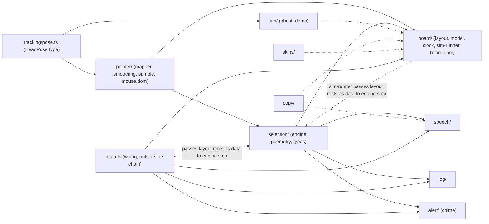
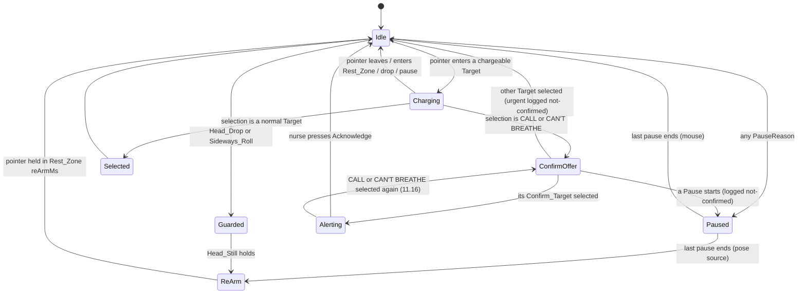

# Design Document

## Overview

This design builds slice 1 of PLANCHETTE: the talking board a judge can drive end to end with the mouse or a simulated patient, with no camera, in both skins. It covers the board at all three levels, dwell selection with the rest zone and the head-drop guard, the confirm step, urgent alerts with a gentle chime, speech, the message strip and Level 3 spelling, the in-memory session log, the screen wake lock, pause for care, the two skins, the nurse drawer, and the simulation checks that prove the safety rules.

The whole slice is written so that the safety rules are **pure functions of state and time**, testable in Node with fast-check and ghost simulations, with no browser. Three ideas carry that:

1. **A pure selection engine.** `selection/engine.ts` is a state machine. It takes the pointer samples, the active target rectangles and the time, and returns the next state plus a list of events. It reads no clock, touches no DOM, and imports nothing from `board/`.
2. **A pure screen model.** `board/model.ts` turns the engine state, the level, the skin and the overlays into a plain description of what is on screen: which targets, where, their charge, which overlays cover what, every strip and banner, and the skin. The `board/board.dom.ts` renderer only draws that model. Every "what must be on screen" rule (the banner on every screen, the clock on every screen, nothing covering CALL or CAN'T BREATHE, a covered target never charging, the same words in both skins) becomes a fast-check property over the model, with no browser.
3. **A pure ghost simulator.** `sim/` produces head pose over time from a profile, a seed and a goal pose. It never sees a target id, so it never imports `board/`. A simulation runner in `board/` (`board/sim-runner.ts`) turns a target into a goal pose by inverse-mapping the layout, and drives the simulator through the pointer and the engine.

PLANCHETTE is a prototype. It is not a medical device and does not replace the hospital's call system.

### How this design maps to the requirements

Every section below names the requirement criteria it satisfies. The Correctness Properties section names one property per in-scope safety.md ID, and the Testing Strategy says where each test lives and how long it runs. Numbers marked TUNE are starting values; the default Dwell_Time comes from the Dwell_Sweep (Requirement 23.4, 23.5).

### Research that shaped the design

- **Browser sound before a user gesture (Requirement 21).** Current Chrome creates an `AudioContext` in the `suspended` state and only lets it start after the page has received a user gesture; the fix is to call `audioContext.resume()` in or after a real click or key press ([Chrome, "Web Audio, Autoplay Policy and Games"](https://developer.chrome.com/blog/web-audio-autoplay), [Chrome autoplay policy](https://developer.chrome.com/blog/autoplay)). `speechSynthesis.speak()` has been blocked without user activation since Chrome M71, and a single earlier gesture anywhere in the document's lifetime is enough to unlock it for the rest of the session (summarised on [Stack Overflow](https://stackoverflow.com/questions/54265423/javascript-speechsynthesis-speak-without-user-activation-is-no-longer-allowed/54266831)). Content was rephrased for compliance with licensing restrictions. This matches Requirement 21 exactly: show "Sound is off until someone clicks this page. Click anywhere to turn it on.", then on the first click or key press resume the `AudioContext` and mark speech unlocked, and make sure that first click selects nothing (21.3).
- **Hidden-tab timer throttling (open question 8).** Background tabs throttle `setTimeout`/`setInterval`, which would stretch the 6-second chime repeat. The design schedules chime notes ahead on the `AudioContext`'s own clock (`currentTime` + offsets) instead of waking a timer for each note, so the repeat holds while the tab is hidden (Requirement 11.14).
- **Medical alarm shape (Requirement 11.5).** IEC 60601-1-8 alarm signals are bursts of several short pulses with sharp onsets. The PLANCHETTE chime is deliberately the opposite: two slow sustained notes with a soft attack. See "Alerts, chime and Test sound".

---

## Architecture

### Module and file list

Folders follow structure.md. Two new homes are needed and were approved as decisions in "Decisions that need your approval": `src/alert/`, and the doc folders `docs/experiments/` and `docs/evidence/`. The simulation runner is a board module, `src/board/sim-runner.ts`, so it needs no new home.

The one-way chain is **tracking → pointer → selection → board → speech, log, alert**. A module never imports from a module later in that chain; `speech/`, `log/` and `alert/` share the last place. `copy/`, `skins/` and `sim/` sit outside the chain, and any stage may import them; `sim/` itself imports only `tracking/`, `pointer/clamp.ts` and its own files. `main.ts` sits outside the chain and may import anything. Test files follow the same rule (see "Testing Strategy"): a test imports only modules at or before its own folder's place in the chain, plus `copy/`, `skins/` and `sim/`.

| File | Job | May import |
|---|---|---|
| `src/tracking/pose.ts` | `HeadPose` type (yaw, pitch, roll in degrees). The camera device code arrives in spec 2; this slice needs only the type. | nothing |
| `src/copy/index.ts` | Every string a patient, family or nurse sees or hears: labels, first-person sentences, confirm labels, system and pause messages, notice wording, the Level 3 demo word list. Named exports, no DOM. | nothing |
| `src/copy/copy.test.ts` | The wording test (Requirement 20.3): scans every string and every Ghost_Profile name/description for forbidden topics, "ghost", the NEV-7 words and the trademarked name. | copy, sim profiles |
| `src/skins/tokens.ts` | Colour tokens per skin as pure data (hex values), plus the computed WCAG ratios used by the contrast test. | nothing |
| `src/skins/skin.ts` | Pure Skin_Manager: given the session state (alert active, offer made, choice, address switch), returns which skin is shown. | nothing |
| `src/skins/ward.css`, `candlelight.css` | Visuals only: colour, texture, the planchette pointer shape, the candle-flame charge ring, the slow light drift. No geometry. | — |
| `src/pointer/clamp.ts` | Clamp a number to a range (exists). | nothing |
| `src/pointer/sample.ts` | `BoardPosition`, `PointerSource`, `PointerSample` types. | tracking/pose |
| `src/pointer/mapper.ts` | Default_Range mapping pose ↔ board position (forward and inverse), with clamp. Pure. | clamp, sample, pose |
| `src/pointer/smoothing.ts` | Pointer smoothing and slow-drift recentring. Pure, time as input. | clamp, sample |
| `src/pointer/mouse.dom.ts` | Turns DOM mouse events into `PointerSample`s (no head pose). | sample |
| `src/selection/geometry.ts` | Point-in-rect and rectangle-overlap math. Pure. | selection/types (`Rect`) |
| `src/selection/types.ts` | `EngineConfig`, `EngineState`, `EngineEvent`, `PauseReason`, `ActiveTarget`. | pointer types, pose |
| `src/selection/engine.ts` | The pure state machine: dwell, rest zone, pauses with priority, head-drop/roll guard, re-arm, confirm offer, alert state, spelling. Hit-tests injected target rectangles. | pointer, selection/geometry, selection/types |
| `src/board/layout.ts` | The Layout_Table: for every Target and Confirm_Target, its id, rect in Board_Units, usage tier, levels and kind. The one source of positions. Pure data + helpers (`rectsForLevel`, `restZone`). | selection/types (Rect) |
| `src/board/demo-script.ts` | The fixed demo script: ordered target ids per level, and the Level 3 demo word key. Data only (ids, no geometry). | copy (word key) |
| `src/board/model.ts` | The pure screen model: engine state + level + skin + overlays → what is shown and where, and which targets may charge. | selection, layout, skins/skin, copy |
| `src/board/clock.ts` | Pure: a time in ms → the Clock_Line text (weekday, day, month, HH:MM). | copy |
| `src/board/switches.ts` | Pure: a query string → the start config (level, skin, mouse, ghost, ignored switches). | layout, sim profile names |
| `src/board/sim-runner.ts` | The simulation runner: reads the demo script and the layout, inverse-maps ids to goal poses through the pointer, drives `sim → pointer → selection` with `activeTargets` and the pause-message reducer from the model, and collects the engine's events. Counts what would be spoken or alerted from the engine's own `speak` and `alert-start` events. Exports `restRun`, `activeUseRun`, `fatigueReachRun` and the runtime demo pointer. Uses no Vite-only feature, so `scripts/dwell-sweep.mjs` can run it in plain Node. | sim, pointer, selection, board (never speech, log or alert) |
| `src/board/board.dom.ts` | The renderer: draws the screen model, the nurse drawer and overlays; wires DOM events for nurse controls and the sound-unlock click. | model, skins/tokens, copy |
| `src/board/clock.dom.ts` | Ticks the minute and asks the renderer to refresh the Clock_Line. | clock |
| `src/board/wake-lock.dom.ts` | Screen wake lock: request on start and on visibility, re-request on release, report refusal. | — |
| `src/speech/speech.ts` | Pure speech queue: selection events → the ordered list of utterances, with urgent interrupts, and a "Demo." utterance before each sentence in a Demo_Session (13.12). | copy, selection/types |
| `src/speech/speech.dom.ts` | `speechSynthesis` wrapper; prefers a local English voice; never blocks a selection. | speech |
| `src/log/log.ts` | The in-memory Session_Log: append and query. Pure, time as input, no storage this slice. | selection/types |
| `src/alert/chime.ts` | Pure chime: the two-note pattern as data, and `nextChimeTimes(startedAtMs, now, config)` for ahead-of-time scheduling and the bounded rise. | — |
| `src/alert/chime.dom.ts` | Web Audio player: schedules the pure pattern on the `AudioContext` clock. | chime |
| `src/sim/pose-types.ts` | `GhostProfile` type and the profile JSON schema. | tracking/pose |
| `src/sim/ghost.ts` | Pure simulator: profile + seed + mode + goal pose + time → `HeadPose`, with range, tremor, drift, fatigue, dozing rolls and face loss, and the roll→yaw/pitch coupling. | pose-types, pose, pointer/clamp |
| `src/sim/demo.ts` | Pure: alternates rest and aim over a list of **goal poses** (not ids) with dwell timing; emits a `HeadPose` stream. | ghost, pose |
| `src/sim/profiles/*.json` | The six Ghost_Profiles (written by the ghost-patient-designer agent). | — |
| `src/main.ts` | Wiring entry: reads switches, builds the input source (mouse, or the demo pointer from `board/sim-runner.ts`), runs the frame loop, renders, drives the dom adapters. | everything (wiring) |

Files not created in this slice (named here so the chain stays clear): `src/tracking/` camera code, `src/ask/`, `src/predict/`, `src/api/`, `api/`. They arrive in later slices.

### Dependency direction and the one hard case

The selection engine must know which target the pointer is over, and the target rectangles live in `board/layout.ts`. But `selection` is **before** `board` in the chain, so `selection` must not import `board`. The design resolves this by **injection**: the engine is parameterised over the active target rectangles. Each tick the simulation runner `board/sim-runner.ts` (in simulations) or `main.ts` (in the app) reads `board/layout.ts`, applies the overlay and confirm rules to get the list of currently chargeable `ActiveTarget{ id, rect }`, and passes that list into `engine.step(...)`. The engine does the point-in-rect test itself (pure math in `selection/geometry.ts`) and never imports `board`. The board, which is later in the chain, reads the engine's state to render — that is an allowed import of an earlier module. No import cycle exists because the layout is passed as **data**, not imported.



Arrows point from the imported module to the module that imports it. The two dotted "passes layout rects" edges are calls with data, not imports, so no module imports a later stage.

---

## Data Models

All types are plain TypeScript, named exports, no classes needed. Board_Units are defined so that **1 unit = 1% of the Shorter_Side**; see "Layout geometry".

```ts
// tracking/pose.ts
export type HeadPose = { yawDeg: number; pitchDeg: number; rollDeg: number };
// yaw: + is the patient's right (screen +x). pitch: + is up (screen -y). roll: + tips the crown to the right.

// pointer/sample.ts
export type BoardPosition = { x: number; y: number };     // Board_Units; (0,0) top-left
export type PointerSource = 'mouse' | 'demo';
export type PointerSample = {     // the glossary's Pointer_Sample; types are PascalCase (structure.md)
  tMs: number;                       // time is an input; pure code never reads the clock
  position: BoardPosition | null;    // null when the mouse is off the board, or the face is lost
  pose: HeadPose | null;             // null in Mouse_Mode
  source: PointerSource;
};

// selection/types.ts
export type Rect = { x: number; y: number; w: number; h: number };  // Board_Units, top-left + size
export type Level = 1 | 2 | 3;
export type ActiveTarget = { id: string; rect: Rect; chargeable: boolean };
export type PauseReason =
  | 'paused-for-care' | 'no-input' | 'face-out-of-view' | 'head-below-range' | 'screen-hidden'
  | 'screen-too-narrow'       // Requirement 3.8
  | 'head-held-rolled';       // Requirement 8.12
export type UrgentId = 'call' | 'cant-breathe';

export type EngineConfig = {
  dwellMs: number;            // from the Dwell_Sweep; 1500 until it has run
  restZone: Rect;
  headDropDeg: number; headDropWindowMs: number;     // 8°, 500 (TUNE)
  rollDeg: number; rollWindowMs: number;             // 10°, 500 (TUNE)
  stillDeg: number; stillWindowMs: number;           // 2°, 1000 (TUNE)
  faceGapMs: number;          // 500 (TUNE): no pose for longer => face-out-of-view
  belowRangeDeg: number;      // 3° below the Default_Range floor (TUNE)
  heldRollDeg: number; heldRollMs: number;           // 10°, 2000 (TUNE): Head_Held_Rolled (8.12)
  reArmMs: number;            // 400 (TUNE)
  selectPulseMs: number;      // 1000 (TUNE): the "selected" outline/text cue
};

export type Alert = { urgent: UrgentId; startedMs: number; lastChimeMs: number; step: number };
export type Unconfirmed = { urgent: UrgentId; selectedMs: number };

export type EngineState = {
  chargingId: string | null;
  charge: number;             // 0..1
  pauses: Set<PauseReason>;
  reArmUntilRestSinceMs: number | null;   // in Re_Arm until the pointer holds the rest zone reArmMs
  guardBlocked: boolean;                   // a drop/roll is in progress or not yet still
  rollHeldSinceMs: number | null;          // when |roll| last reached heldRollDeg; null while under it
  confirm: { urgent: UrgentId; openedMs: number } | null;
  alerts: Alert[];                         // 0..2, CAN'T BREATHE named first
  spelling: string;
  unconfirmed: Unconfirmed[];
  lastSelectionId: string | null;
  soundUnlocked: boolean;
};

export type EngineEvent =
  | { kind: 'selection'; id: string; tMs: number }
  | { kind: 'confirm-open'; urgent: UrgentId; tMs: number }
  | { kind: 'confirm-close'; urgent: UrgentId; confirmed: boolean; tMs: number }
  | { kind: 'unconfirmed'; urgent: UrgentId; selectedMs: number }
  | { kind: 'alert-start'; urgent: UrgentId; tMs: number }
  | { kind: 'alert-repeat'; urgent: UrgentId; tMs: number }
  | { kind: 'alert-ack'; tMs: number }
  | { kind: 'speak'; textKey: string; tMs: number }       // a key into copy, or spelled text
  | { kind: 'spelling'; text: string; tMs: number }
  | { kind: 'pause-start'; reason: PauseReason; tMs: number }
  | { kind: 'pause-end'; reason: PauseReason; tMs: number };

// log/log.ts
export type LogEntry = {
  tMs: number;
  kind: 'selection' | 'urgent' | 'not-confirmed' | 'alert-start' | 'alert-ack'
      | 'pause-start' | 'pause-end' | 'care-on' | 'care-off' | 'level' | 'skin'
      | 'input-source' | 'test-sound' | 'wake-lock-refused' | 'notice-cleared';
  about: string;              // a Target id, a PauseReason, 'call'/'cant-breathe', or spelled text
  demo: boolean;              // SAF-10 mark
};
// The Session_Log stores no camera frame, no head pose, no landmark and no pain score (NEV-4, 15.5).

// speech/speech.ts
export type SpeechItem = { text: string; urgent: boolean };
// In a Demo_Session each sentence is preceded by its own item { text: 'Demo.' } (13.12),
// so the sentence and any spelled text are spoken unchanged (14.6).
```

The ghost profile type follows tech.md exactly:

```ts
// sim/pose-types.ts
export type GhostProfile = {
  name: string; description: string; notes: string; seed: number;
  rangeDeg: { left: number; right: number; up: number; down: number };
  tremor: { amplitudeDeg: number; frequencyHz: number };
  driftDegPerMin: number;
  fatigue: { rangeLossPctPerMin: number };
  dozing: { everyMin: number; durationS: number; dropDeg: number; direction: 'down'|'left'|'right' } | null;
  faceLost: { everyMin: number; durationS: number } | null;
};
```

---

## Layout geometry (done first)

Board_Units: **1 unit = 1% of the Shorter_Side.** On a landscape board the height is the shorter side, so height `H = 100` units and width `W = 100 × (widthPx / heightPx)`. The design is anchored on the board centre `Wc = W/2` and sized so it fits the narrowest required viewport.

| Viewport | Aspect | W (units) | H (units) |
|---|---|---|---|
| 1280×800 | 16:10 | 160.0 | 100 |
| 1366×768 | ~16:9 | 177.9 | 100 |
| 1920×1080 | 16:9 | 177.8 | 100 |

The binding case is 1280×800 (W = 160). Everything below fits within x ∈ [0, 160], so it also fits the two wider viewports.

### The rest zone and the three bands

The Rest_Zone is centred: **x ∈ [Wc−14, Wc+14], y ∈ [37, 63]** (28 units wide, 26 tall ≥ 20, Requirement 3.5). Its top edge is y = 37. It is drawn as an outline with no fill, and the word "REST" sits at its centre (Wc, 50), anchored by the Layout_Table like every other position (Requirement 7.11). That gives three bands:

- **Top band** y ∈ [0, 37): holds the Urgent_Targets, both Confirm_Targets and SPEAK, all entirely above the rest zone (Requirement 1.7, SAF-7).
- **Middle band** y ∈ [37, 63]: the rest zone, with YES to its left and NO to its right (tier 1, nearest the rest zone, Requirement 1.8 order and LAY-3).
- **Bottom band** y ∈ (63, 100]: the lower needs and letters.

### Level 1 — exact rectangles (Board_Units)

| Target | x | y | w | h | Smaller side | Centre |
|---|---|---|---|---|---|---|
| CALL | 16 | 4 | 30 | 28 | 28 (≥25 ✓) | (31, 18) |
| CAN'T BREATHE | 114 | 4 | 30 | 28 | 28 ✓ | (129, 18) |
| YES | 35 | 36 | 29 | 28 | 28 ✓ | (49.5, 50) |
| NO | 96 | 36 | 29 | 28 | 28 ✓ | (110.5, 50) |
| Confirm "YES, CALL" | 48 | 4 | 46 | 28 | 28 ✓ | (71, 18) |
| Confirm "YES, CAN'T BREATHE" | 48 | 3 | 64 | 30 | 30 ✓ | (80, 18) |

Checks (binding viewport W = 160):
- **All Fixed_Targets and Confirm_Targets ≥ 25 units smaller side** (Requirement 3.1). ✓
- **Gaps ≥ 2 units** (Requirement 3.4, 1.6, 10.2): CALL↔YES are 4 units apart vertically; YES↔rest zone 2 units; CALL↔"YES,CAN'T BREATHE" confirm 2 units; CALL(right 46)↔"YES,CALL" confirm(left 48) 2 units; "YES,CAN'T BREATHE" confirm(right 112)↔CAN'T BREATHE(left 114) 2 units. ✓
- **Only one Confirm_Target shows at a time** (one Confirm_Offer, except that during an alert a second may open, 11.16), so the two confirm rectangles never appear together and never overlap each other in use.
- **Above the rest zone** (SAF-7, 1.7): CALL, CAN'T BREATHE, both confirms and SPEAK have their bottom edge ≤ 33 < 37. ✓

### "YES, CAN'T BREATHE" at 6vmin (nurse review item 10)

At 6vmin cap height the font size is about 0.086 × Shorter_Side, and a heavy uppercase glyph advances about 0.55em, so a line of *n* characters needs about `n × 4.7` units. "YES, CAN'T BREATHE" is 18 characters → about **85 units** on one line. A single-line confirm 85 units wide, placed beside CAN'T BREATHE, would cover CALL, which must stay uncovered and selectable (Requirement 11.6, 10.10, blocker 2). So the design **wraps the confirm label to two lines** — "YES," over "CAN'T BREATHE" — whose longest line ("CAN'T BREATHE", 13 chars) needs about **61.5 units**, held in a 64-unit-wide box. This keeps the label at ≥ 6vmin and does **not** abbreviate CAN'T BREATHE, honouring the nurse's two firm asks; it diverges only on "without wrapping", because keeping CALL reachable wins. "YES, CALL" (9 chars, ~43 units) fits one line in its 46-unit box. This is a layout choice, not a requirement change (10.3 keeps the wording).

### The Message_Strip at doorway size (Requirement 13.14, nurse review item 6)

Each new sentence shows at 8vmin or more for 8 s, so the strip's rectangle must hold that size. At 1280×800, 8vmin is 8 Board_Units of cap height, so the font size is about 11.4 units, and heavy mixed-case text advances about 5.9 units per character. The longest fixed sentence, "I can't breathe. Please come now." (33 characters), needs about 195 units on one line, more than the Board's 160. On two lines ("I can't breathe." over "Please come now.", 16 characters each) it needs about **96 units wide and 26 units tall** at a line height of 1.15. Every other sentence in 13.5 fits the same box on two lines.

Level 1 leaves about 34 units free below YES and NO (y from 66 to 100), enough for the box if the Clock_Line, the Visitor_Hint and the Demo_Banner fit around it. Levels 2 and 3 fill most of that band with needs, letters and the Spelling_Line, and the free strip below Level 2's lower needs is only about 16 units tall. The design does not move any Target to make room. Task 5.1 places the strip rectangle outside every Target and Confirm_Target at every Level (4.5), or stops and asks the user if it can't fit at 1280×800. Spelled text that needs more than two lines at the asked size uses 13.15: the largest size that fits on two lines, and at least 5vmin.

### Level 2 — bands and tiers

Level 2 adds the twelve needs to the four Fixed_Targets. Each need's smaller side is ≥ 15 units (Requirement 3.2). Usage tiers (Requirement 1.8): tier 1 YES/NO (placed at Level 1 rects, closest to the rest zone); tier 2 MOUTH DRY, PAIN, SUCTION, MOVE ME; tier 3 the other eight. Requirement 1.9 needs every tier-2 centre no farther from the rest-zone centre than any tier-3 centre.

Tier 2 takes the four spots nearest the rest zone after YES/NO — the inner top-centre and inner bottom-centre:

| Need | x | y | w | h | Centre | Dist. from (Wc,50) |
|---|---|---|---|---|---|---|
| PAIN | 56 | 14 | 22 | 18 | (67, 23) | ~29.4 |
| SUCTION | 82 | 14 | 22 | 18 | (93, 23) | ~29.4 |
| MOUTH DRY | 56 | 66 | 22 | 18 | (67, 75) | ~28.0 |
| MOVE ME | 82 | 66 | 22 | 18 | (93, 75) | ~28.0 |

Tier 3 takes the eight outer spots (bottom corners, far-left and far-right middle, top outer), every centre ≥ 34 units from the rest-zone centre, so the tier-2 ≤ tier-3 ordering holds. Representative tier-3 rects: TOO HOT `{4,40,28,18}` centre (18,49) dist ~62; THE TUBE `{128,40,28,18}` centre (142,49) dist ~62; TOILET `{10,66,26,18}` centre (23,75) dist ~61; NOISE `{124,66,26,18}` centre (137,75) dist ~61; the remaining four (TOO COLD, LIGHTS, GLASSES, HEARING AID) fill the bottom band outboard of MOUTH DRY/MOVE ME and the top band outboard of PAIN/SUCTION, all centres ≥ 34. The layout table carries the exact rects; the geometry test (below) checks all of them at the three viewports.

A greyscale note: twelve two-word labels plus four Fixed_Targets and two possible confirms nearly fill a 16:10 board. The geometry test fails loudly if any gap drops below 2 units or any need below 15 units at any of the three viewports, so a TUNE size change is caught in CI, not by eye.

### Level 3 — letters

Level 3 shows the Fixed_Targets, A–Z, SPACE, DELETE, SPEAK and the Spelling_Line. Each letter tile is **10 × 10 units** (≥ 9, Requirement 3.3) with 2-unit gaps (pitch 12). Tiles are laid **alphabetically** left to right, top to bottom (open question 12: easier for a confused patient than frequency order) across the three regions outside the rest zone and the Fixed_Targets: the top-centre band, the two side margins, and the bottom band. These regions hold at least 29 tiles at a 12-unit pitch, enough for 26 letters + SPACE + DELETE. SPEAK is a tile in the **top band** at `{70, 4, 20, 14}` (centre (80, 11)), so its bottom edge (y = 18) sits above the rest zone's top edge (y = 37), as SAF-7 and Requirement 1.7 require. Both Confirm_Targets overlap that rectangle, so while a Confirm_Offer is open the Board hides SPEAK and the engine does not charge it (Requirements 1.11 and 10.10). The Spelling_Line is a strip at the very bottom, y ∈ [92, 99], outside every target rectangle (Requirement 4.5, 14.8), with a visible caret.

Level 3 has no needs and no numbers in this slice (requirements notes, conflicts 2 and 5); that is recorded, not solved here.

### Reachability of the urgent targets (SAF-1, Requirement 23.3)

Mapping (see "Pointer mapping"): neutral pose (0,0) → rest-zone centre (Wc, 50); the Default_Range edges → the board edges. So a target centre at (x, y) needs:

`yawDeg = (x − Wc) / (W/2) × 10`,  `pitchDeg_up = (50 − y) / 50 × 8`.

At the binding viewport (W = 160, half-width 80):

| Target | Centre | Yaw needed | Pitch up needed |
|---|---|---|---|
| CALL | (31, 18) | −6.13° | 5.12° |
| CAN'T BREATHE | (129, 18) | +6.13° | 5.12° |
| "YES, CALL" confirm | (71, 18) | −1.13° | 5.12° |
| "YES, CAN'T BREATHE" confirm | (80, 18) | 0° | 5.12° |

The Default_Range is 10° yaw and 8° pitch, so both urgent targets and both confirms sit inside it with margin. Two constraints follow for the ghost-patient-designer:
- The **small-range** profile (≤ 10° of turn) must keep at least ~6.2° of yaw each way and ~5.2° of up-pitch, or CALL/CAN'T BREATHE become unreachable.
- The **fatigue** profile must, after 30 simulated minutes of loss, still retain ~6.2° yaw and ~5.2° up-pitch, so the Fatigue_Reach_Run (23.3) can select CALL then YES,CALL (and the same for CAN'T BREATHE) within 10 s at every level.

Both are stated as profile constraints (TUNE) so 23.3 is a real test of the layout and the mapping, not of an unreachable corner.

### Other viewports

The layout needs a Board at least **160 units wide**, the width of the binding 1280×800 case: Level 2's outer needs span x ∈ [4, 156]. The urgent targets alone need less (CALL's left edge to CAN'T BREATHE's right edge is 128 units, which a 4:3 landscape board, W = 133.3, would hold), but every Level shows the same rectangles (LAY-1), so the whole table sets the minimum. **Portrait never fits**: when the width is the shorter side, the board is only 100 units wide.

A Board narrower than 160 units (TUNE) is a **Narrow_Screen**. Requirement 3.6 lists only the three landscape viewports, so the design does not lay targets out on a Narrow_Screen. Instead the engine holds a Pause with the reason `screen-too-narrow`, and the Board shows, in place of the Targets, the pause message "Screen too narrow. Selection is off. Turn the screen sideways or use a wider screen." from `src/copy/`, with the 8vmin reason line of every pause message (8.6). The Clock_Line, the Nurse_Handle, the Demo_Banner in a Demo_Session and the Alert_Panel of any active Alert stay on screen. The Session_Log records when the reason starts and ends, like every Pause_Reason (8.10). While it holds, CALL and CAN'T BREATHE are not on screen, as in every Pause (requirements, conflict 7). This is new user-facing behaviour, added as Requirement 3.8 and approved on 2026-11-27 (see "Decisions that need your approval").

---

## Components and Interfaces

### The selection engine

`engine.step(state, sample, active, config, env) → { state, events }` is pure. `active: ActiveTarget[]` is the list of currently chargeable rectangles (the simulation runner or `main.ts` computes it with `activeTargets` from the layout and the overlay rules). `env` carries what the engine cannot derive from a sample: `tabHidden`, `narrowScreen` (Requirement 3.8), `pausedForCare`, `careEndsAtMs`, `hasInput`, and `soundUnlocked`. Everything else (which target is pointed at, drops, rolls, stillness, re-arm, charge, confirm, alert, spelling) the engine computes from the sample stream and time.

Priority of behaviour each tick, highest first:

1. **Pauses.** Compute the active `PauseReason` set from `env` and the sample: `screen-hidden` (tabHidden), `screen-too-narrow` (narrowScreen), `no-input` (!hasInput), `paused-for-care`, `face-out-of-view` (a pose source with no pose for > `faceGapMs`), `head-below-range` (pitch > `belowRangeDeg` below the Default_Range floor), `head-held-rolled` (|roll| ≥ `heldRollDeg` from 0° without a break for ≥ `heldRollMs`, tracked by `rollHeldSinceMs`; it ends on the first sample with |roll| < `heldRollDeg`, and never holds without a pose). While any hold: set charge 0, charge nothing, emit `pause-start`/`pause-end` on changes, and (if a pose source) when the last pause ends enter Re_Arm. A Confirm_Offer open at a pause start closes as "not confirmed".
2. **Head-drop / roll guard.** From the pose stream: a Head_Drop (pitch falls ≥ `headDropDeg` within `headDropWindowMs`) or a Sideways_Roll (roll changes ≥ `rollDeg` within `rollWindowMs`) sets charge 0 and `guardBlocked = true`; it clears only when Head_Still holds (pitch and roll each change < `stillDeg` over `stillWindowMs`), after which Re_Arm begins. In Mouse_Mode (no pose) the guard is inert (Requirement 9.4).
3. **Re_Arm.** After any pause ends, the held-roll pause included, or after a drop/roll clears, charge nothing until the pointer has stayed inside the Rest_Zone for `reArmMs`. In Mouse_Mode only a pause end triggers Re_Arm. (Requirement 9.6.)
4. **Rest zone.** While the pointer is inside the Rest_Zone: charge nothing, and (if re-arming) accumulate rest-zone time.
5. **Dwell.** Otherwise, find the pointed `ActiveTarget` (point-in-rect). If it equals `chargingId`, grow charge by `dt / dwellMs`; at charge ≥ 1 emit one `selection`, set charge 0, and do not recharge that target until the pointer leaves it. If the pointed target changed (or is none, or not chargeable), set charge 0 and start the new target at 0. Charge at most one target.
6. **Selection effects.** A normal target emits `speak` (its sentence) and a log selection. An Urgent_Target opens a Confirm_Offer (no speak, no alert yet). A Confirm_Target selection starts the Alert and speaks the urgent sentence. SPEAK with text speaks and clears the Spelling_Line; letters/SPACE/DELETE edit the Spelling_Line and are never spoken.



Confirm offer rules (Requirement 10): it closes on its Confirm_Target (→ Alert), on any other selection (that selection proceeds; the urgent one is logged "not confirmed" and raises an Unconfirmed_Notice), or on a pause start (logged "not confirmed", notice raised). It never closes on time, on resting, or on a level/skin change. A raised Unconfirmed_Notice makes no sound, speaks nothing and starts no alert (10.13); it stays until the nurse clears it and survives level, skin, pause, alert and acknowledge (10.12).

Alert rules (Requirement 11): up to two alerts (CAN'T BREATHE named first, 11.13); a repeat confirm of an already-alerting urgent keeps one alert but re-speaks and logs the repeat (11.12); Acknowledge ends every alert (11.9). While any alert is active the whole screen is Ward (11.7) and stays Ward after Acknowledge until the nurse offers Candlelight again (11.11).

### Pointer mapping and drift

`mapper.ts` maps pose to board position with `x = Wc + clamp(yaw/10, −1, 1) × (W/2)` and `y = 50 − clamp(pitch/8, −1, 1) × 50`, and the inverse `poseForPosition` used by the simulation runner to turn a target centre into a goal pose. The Default_Range is 10° yaw and 8° pitch (TUNE).

`smoothing.ts` does two things, both time-as-input:
- **Smoothing.** A one-euro-style low-pass on the mapped position: more smoothing when the head is slow (less jitter at rest), less when it is fast (no lag on a reach). Pure; state carried between samples.
- **Slow-drift recentring** (requirements open question 7). Drift of up to 2°/min would otherwise walk a resting pointer off the Rest_Zone and fail the Rest_Runs. The mapper subtracts a slowly moving neutral estimate: an exponential moving average of the pose with a long time constant (τ ≈ 60 s, TUNE), updated **only while the head is roughly still and near the current neutral**. The trade-off is stated so drift handling can never block a reach: a reach is several degrees within a second — far faster and larger than the recentring gate — so it bypasses the estimate entirely; only slow, small residuals near neutral move it. A dwell hold (≈ 1.5 s) is far shorter than τ, so holding on a target to select it does not get learned as neutral.

### Waking and a head held rolled (the re-arm rule and the held-roll pause)

Two moments break a naive design, and both are why 9.6 (re-arm) was proposed:

- **Waking from below range.** A `head-below-range` pause ends as the head lifts; the pointer rises through the lower targets. Without re-arm, one of them could charge on the way up. With re-arm, nothing charges until the pointer has returned to the Rest_Zone (which the head passes through near neutral), so the lower targets are safe on the way up.
- **A head held rolled** (nurse review item 3). The dozing-roll profile rolls the head and, once it stops moving, leaves it parked. The roll→yaw/pitch coupling (below) means a parked rolled head sits off-centre, often over a target. The Head_Drop_Guard releases as soon as Head_Still returns, so without re-arm the parked pointer would charge and speak while the patient dozes — failing the Rest_Run. With re-arm, a parked rolled head is **not** in the Rest_Zone, so it never re-arms, so it never charges.

**Comparison of the three options:**

| Option | Dozing-roll Rest_Run | Waking through lower targets | Cost to the patient | Names a clinical state? |
|---|---|---|---|---|
| Do nothing | Fails (parked roll charges) | Fails | none | no |
| Held-roll pause (nurse item 3: roll > 10° sustained > 2 s → Pause) | Passes | Not addressed | A patient who rests slightly rolled can be paused out | Borderline — a sustained posture |
| Re_Arm (chosen in the design pass) | Passes | Passes | Must pass back through centre after a pause/doze — natural when returning to neutral | no |
| **Re_Arm and the held-roll pause (adopted at task approval)** | Passes | Passes | A head resting rolled 10° or more is paused, with the reason on screen | no: "Head tilted to one side." names a position |

Re_Arm was chosen in the design pass because one rule fixes both moments, costs only a pass through the centre (where the resting pointer already is at neutral), and never names a clinical state. The cost to reachability is bounded: after a pause or doze the patient brings the pointer to centre (lifting the head to neutral) and then aims; SAF-1 "reachable in one selection" is read as "from a screen where selection is on", and re-arm is not a selection. In **Mouse_Mode** there are no drops or rolls, so re-arm triggers only after a pause ends; the mouse must pass through the Rest_Zone once before charging resumes, which is mild and uniform. `reArmMs` is 400 ms (TUNE).

**The held-roll pause (Requirement 8.12, adopted at task approval).** Re_Arm only follows a fast roll: a Sideways_Roll, 10° within 500 ms. A slow roll starts neither the guard nor Re_Arm, so it can walk the pointer onto a Target and park it there. The `head-held-rolled` Pause_Reason holds while |roll| has stayed at or above `heldRollDeg` (10°, TUNE) from 0° for `heldRollMs` (2 s, TUNE), and ends as soon as |roll| is back under 10°. It is a Pause like every other: the Charge goes to zero, nothing is selected, the start and end are logged, an open Confirm_Offer closes as not confirmed, and Re_Arm follows its end. The message is "Head tilted to one side. Selection is off.", last in the message order. Neutral roll is 0° in this slice, never the drift-recentring estimate, so a slow roll is never absorbed into neutral. In the dozing-roll profile's 60-second dozes the guard acts first (the roll is fast), and the held-roll pause holds from 2 s into the doze until the head comes back.

**Residual risk.** A slow roll smaller than 10°, parked over YES or NO, is not caught. With the coupling below (about 0.6° of yaw and 0.3° of pitch per degree of roll, TUNE), each degree of roll moves the pointer about 4.8 Board_Units sideways and 1.9 up or down at 1280×800. The pointer leaves the Rest_Zone at about 2.9° of roll and sits on YES or NO from about 3.3° to 7.5°; above that the pitch coupling takes it above NO or below YES. Held there for one Dwell_Time, it selects and speaks "Yes." or "No.". On Levels 2 and 3 a nearby need or letter can be hit the same way.

**Will SAF-3b pass with the starting values?** Probably not, for two reasons the user should decide on (task 11.9 stops and asks if it fails):
- *The ramp.* A slow roll on its way to 10° crosses YES or NO, which span about 4.1° of roll. Slower than about 2.8° per second at a 1500 ms Dwell_Time (faster for a shorter one), it selects one of them on the way.
- *CAN'T BREATHE before the 2 s are up.* A right roll of 10° puts the pointer at about (128, 31) at 1280×800, just inside the lower edge of CAN'T BREATHE (x 114 to 144, y 4 to 32); any right roll from about 9.6° to 13° parks it there. The Dwell_Time is shorter than the 2 s hold, so CAN'T BREATHE is selected and opens a Confirm_Offer before the pause starts; the pause then closes it as not confirmed and raises an Unconfirmed_Notice. Nothing is spoken and no Alert starts, so SAF-2 and SAF-3 hold, but SAF-3b's "no Selection" does not. A left roll of 10° lands at about (32, 69), on TOILET at Level 2.
- *Options:* stop charging as soon as |roll| reaches `heldRollDeg` and start the Pause, its message and its log entries after `heldRollMs`; lower `heldRollDeg` toward 3°, which pauses a patient who rests slightly rolled; change the coupling only from volunteer recordings, never to make a test pass.

### The ghost simulator and the one-way chain

`sim/ghost.ts` is pure and imports only `tracking/pose.ts` and `pointer/clamp.ts`. Signature: `pose(profile, seed, mode, goalPose, tMs) → HeadPose`, where `mode` is `'rest'` or `'aim'` and `goalPose` is a `HeadPose` (null in rest). It applies, in order: the base pose (neutral in rest, a damped move toward `goalPose` within the current range in aim); the current range after fatigue loss (`rangeLossPctPerMin × minutes`); tremor (a sine at `frequencyHz`, amplitude `amplitudeDeg`); slow drift (`driftDegPerMin`, a slow ramp); dozing; and face loss (returns a pose-less sample window). It never sees a target id, so it never imports `board`.

**Roll coupling (point 4).** Lying back at 30–45°, a lateral roll also shifts the apparent yaw and pitch. When the profile's dozing direction is `left` or `right`, the simulator adds, during the roll, `Δyaw = kYaw × rollDeg` and `Δpitch = kPitch × rollDeg` (coupling factors, TUNE, e.g. kYaw ≈ 0.6, kPitch ≈ 0.3), so a rolled head actually moves the pointer rather than only changing an unused roll angle. This is what makes the dozing-roll Rest_Run meaningful: the roll drives the pointer onto a target, and the guard + re-arm must keep it silent.

Drift, fatigue and face loss map to the pointer stream through the normal mapper: drift and fatigue change the pose the mapper sees; face loss produces samples with `pose: null`, which the engine reads as `face-out-of-view` after `faceGapMs`.

**The simulation runner (in board/).** `board/sim-runner.ts` turns the fixed demo script (ordered target ids per level, from `board/demo-script.ts`) into goal poses by reading the layout centre of each id and inverse-mapping it with `pointer.poseForPosition`. `sim/demo.ts` then alternates rest and aim over those **goal poses**, holding each long enough to select it at the current Dwell_Time. The runner wraps each `HeadPose` into a `PointerSample` through the mapper and smoothing, steps the engine with `activeTargets` and the pause-message reducer from `board/model.ts`, and (for tests) records the events. The demo scripts contain no Urgent_Target and no Confirm_Target; the Level 3 script spells a demo word from the reviewed list in `copy` and then selects SPEAK (Requirement 6.6). The runner imports `sim/`, `pointer/`, `selection/` and `board/` only, never `speech/`, `log/` or `alert/`: the engine's own `speak` and `alert-start` events are enough to count what would be spoken or alerted. `main.ts` uses it to build the runtime demo pointer, `scripts/dwell-sweep.mjs` imports its run functions, and the harness-based safety tests in `src/board/` (SAF-1b, SAF-3a, SAF-3b, SAF-4a and the simulation runs) drive it, so `npm run test:safety` and the safety-tests hook still run them. A speech or log test that needs simulated patients imports it from `board/` too.

### Alerts, chime and Test sound

**Chime pattern (pure data, `alert/chime.ts`).** A soft two-note fall: note 1 ≈ 587 Hz (D5) then note 2 ≈ 440 Hz (A4), each 300 ms with a 50 ms raised-cosine attack and 120 ms release, 150 ms between them, the pair then silent until the next repeat. This is deliberately unlike IEC 60601-1-8 alarm signals, which are bursts of several short pulses with sharp onsets: PLANCHETTE uses two slow sustained notes with a gentle attack and a falling melodic interval (Requirement 11.5).

**Scheduling that survives hidden tabs.** `nextChimeTimes(startedAtMs, now, config)` returns the `AudioContext`-clock times of the notes due in the next window. `chime.dom.ts` schedules those notes on the context's own clock (`ctx.currentTime + offset`) rather than waking a timer per note, so the 6-second repeat holds while the tab is hidden (Requirement 11.14, open question 8). The repeat is every 6 s (TUNE); the level rises one small step at 30 s and 60 s (TUNE), each step a small gain increase, **capped** at a ceiling gain kept well below typical monitor/ventilator loudness (nurse review item 8). The rise is in gain only; the gentle attack never becomes a sudden onset (ATT-2).

**Unlocking sound (Requirement 21).** The `AudioContext` is created on the first user gesture and `resume()`d in that handler; `speechSynthesis` is marked unlocked by the same gesture. Until then the model shows the sound notice (21.1). The unlocking click selects nothing (21.3): the engine ignores a pointer sample whose only cause is the unlock gesture, and mouse mode selects by dwell only, never by click (5.11).

**Test sound (Requirement 12).** A nurse-drawer control plays one chime at the starting level, shows "If you did not hear a chime, turn the volume up.", logs a `test-sound` entry (never an alert), and is shown unavailable while any alert is active.

### Speech

`speech.ts` is a pure queue: it takes selection events and produces the ordered list of sentences to speak. An urgent sentence (after a confirm) clears any queued sentences and is spoken at once (Requirement 13.7). `speech.dom.ts` wraps `speechSynthesis`, prefers a local English voice (`localService: true`), and if none exists or speech fails, the sentence still shows in the Message_Strip, the selection proceeds without waiting, and the nurse drawer shows the no-voice notice (13.8, SAF-6). Only the patient's selected sentences are spoken; letters, SPACE, DELETE, system and pause messages, the word "REST" and alert names are shown, never spoken (13.4).

**Demo speech (Requirement 13.12, nurse review item 4).** `speech.ts` takes the Demo_Session flag as an input. While it is on, the queue puts a separate `{ text: 'Demo.' }` item before each sentence, spelled text included; the sentence item itself is unchanged, so 14.6 and NEV-2a hold. An urgent sentence in a Demo_Session clears the queue and is spoken at once as the pair "Demo." then the sentence. The Message_Strip and the Session_Log never see the "Demo." item (13.13): the Demo_Banner marks the screen and the Demo mark marks the log. The chime is unchanged. "Demo." comes from `src/copy/`.

### Skins

`skins/tokens.ts` holds each skin's colour tokens as pure data, with the computed WCAG ratios. `skins/skin.ts` is the pure Skin_Manager: Ward is the default; Candlelight shows only after an Offer and a choice, never on an alert screen; during any alert the manager returns Ward; after an alert it stays Ward until the next offer (Requirement 16.1, 11.7, 11.11, 25.2). Text that people see calls Ward "the plain look": the Candlelight_Offer's buttons are "Use Candlelight" and "Keep the plain look", and the on-board button and the drawer control are both "Plain look" (16.8, 16.11, 16.13). "Ward" stays the name in the code. The CSS files hold the visuals: Ward is high-contrast and still (only the pointer and charge ring move); Candlelight is dark wood with brass labels, a planchette-shaped pointer whose aiming point is the same point as Ward's, and a charge ring drawn as a filling arc of candle-flame light. The candle light drifts ≤ 10% luminance with a period ≥ 3 s and stops under `prefers-reduced-motion` (Requirement 16.6, accessibility.md).

**Starting colour tokens and contrast (Requirement 22.1, accessibility.md).** Ratios are WCAG relative-luminance contrast against the token behind each.

| Token | Ward | Candlelight | Against | Ratio | Needs |
|---|---|---|---|---|---|
| Board background | `#0B0F14` | `#1A120B` (dark wood) | — | — | — |
| Board label | `#FFFFFF` | `#F2C879` (brass) | background | Ward 18.1:1; Candlelight 8.9:1 | ≥ 7:1 |
| Message strip | `#FFFFFF` | `#F6E4B8` | panel `#15202B` / `#241812` | 15.2:1 / 10.1:1 | ≥ 7:1 |
| Other text | `#D7DEE6` | `#E8D4A8` | background | 12.4:1 / 7.6:1 | ≥ 4.5:1 |
| Pointer | `#49C2FF` | `#FFB84D` | background | 7.1:1 / 6.0:1 | ≥ 3:1 |
| Charge ring | `#8FE3A2` | `#FFC663` | background | 9.6:1 / 7.2:1 | ≥ 3:1 |
| Target border / focus outline | `#9FB2C4` | `#C9A15A` | background | 6.8:1 / 4.1:1 | ≥ 3:1 |
| The word "REST" (7.11) | `#8E9BA8` | `#A88B5C` | background (the Rest_Zone has an outline and no fill) | about 6.8:1 / 5.7:1 | ≥ 4.5:1 (other text) |

The REST token is quieter than the board labels on purpose, so the word does not read as a Target.

These are starting values; the contrast test (`skins/tokens.test.ts`) computes every ratio from the tokens and fails if any drops below its floor, so a token edit is caught in CI.

### Message strip and the REST word

- **Doorway size (Requirement 13.14).** A small pure reducer in `board/model.ts` holds the strip's text and the time it appeared. The model reads it and gives the strip only its text and a cap height: 8vmin until 8 s (TUNE) after the text appeared, then 5vmin; 8vmin for as long as speech is not available (13.9). A new sentence restarts the 8 s. The model has no remaining-time field, and nothing on screen counts the 8 s (ATT-2). The renderer eases between the two sizes over at least 300 ms, so the change never jumps (22.4). Spelled text too long for two lines at the asked size shows at the largest size that fits on two lines, and at least 5vmin (13.15).
- **REST (Requirements 7.11, 7.12).** The model adds one text node, "REST" from `src/copy/`, at the Rest_Zone's centre from `board/layout.ts`, in both Skins. It has no Target border, no tile, no Charge_Ring and no `data-target`. It is never an `ActiveTarget`, so the engine can't charge it, and the speech queue never sees it. Its colour is the "REST" token, which the contrast test checks at 4.5:1 or more.

### Nurse drawer, wake lock, pause for care, switches, clock, no network

- **Nurse drawer.** Part of the screen model (`model.ts`) and rendered by `board.dom.ts`. Opened by the "Nurse menu" handle (click, Enter or Space; Escape closes). Every control is visible on open, ≥ 44 × 44 CSS px, Tab-reachable with a visible focus outline (≥ 3:1), text ≥ 16 px. It is never a Target and carries no `data-target`; the engine never charges it (the simulation runner and `main.ts` pass only board targets as `ActiveTarget`s). It never covers CALL, CAN'T BREATHE, the Confirm_Targets, YES or NO, and a target it covers cannot charge (Requirement 1.11, 17.7). Acknowledge is enabled and first in Tab order only while an alert is active (17.10). The handle shows a notice mark with text for each waiting notice, including each Unconfirmed_Notice by name (17.9, 17.11).
- **Wake lock** (`wake-lock.dom.ts`, Requirement 19). Requests `navigator.wakeLock.request('screen')` on start and again on `visibilitychange` to visible; re-requests on release while visible; on refusal or no support, the model shows the warning, the handle shows its mark, and the log records the refusal; a later success removes the notice. Modelled as a small state machine driven by the real or a fake API so SAF-9 is testable.
- **Pause for care** (Requirement 18). The nurse control adds `paused-for-care` with a resume time `now + 10 min` (TUNE); Resume ends it; it also ends by itself at the resume time; the end is logged as Resume or by-itself. An active alert keeps chiming through care. The board's pause message carries the resume clock time, "Paused for care. Selection is off. Resumes by itself at 03:22." (18.1, 18.7), and the drawer keeps its own line (18.4). The time is the resume time's HH:MM from `clock.ts` with the seconds dropped, so the resume happens during the minute shown. It is fixed when care starts and never changes while the pause holds, so it is a clock time, not a countdown (ATT-2).
- **Switches** (`switches.ts`, Requirement 25). Pure parse of the query string into `{ level, skin, mouse, ghost }`, ignoring unknown switches and values, ignoring `?night=1`. `?mouse=1` wins over `?ghost=`; an unknown ghost name starts with no input and the drawer notice. `?skin=candlelight` starts Candlelight only with `?mouse=1` or a valid ghost, and logs "Candlelight from the address (demo)"; otherwise Ward.
- **Clock** (`clock.ts`, Requirement 4.1, 4.2, ATT-4). Pure `clockText(tMs)` → weekday, day, month word, HH:MM, using fixed English tables in `copy`. `clock.dom.ts` refreshes on the minute without a flash.
- **No network** (Requirement 24). No account or login screen; after load the board makes no network request; fonts, images and sounds are bundled or synthesised (the chime is Web Audio, not a file). A source scan test and an offline Playwright run prove it (below).

---

## Correctness Properties

*A property is a characteristic or behaviour that should hold true across all valid executions of a system — a formal statement about what the system should do. Properties bridge the human-readable requirements and machine-verifiable guarantees.*

There is one property per in-scope / partly-in-scope safety.md ID. SAF-1, SAF-2 and SAF-3 need two each; SAF-3b is Property 32, added at task approval, so the other numbers stay as they were. Each property names its fast-check generators, its assertion, the requirement criteria it validates, and the file its test lives in. Where a claim cannot be a fast-check property (a device state machine, a source scan, an offline browser run, a purely visual rule), it says so and names the test that replaces it. Every test name carries its safety.md ID (structure.md); every property test runs ≥ 200 times, prints the seed on failure, and is tagged `Feature: first-slice, Property <ID>: <text>`.

### Property 1: SAF-1a — urgent targets and a shown confirm are always placed and never covered

*For all* combinations of level (1–3), skin, confirm offer (none / CALL / CAN'T BREATHE), active alerts (none / one / both), nurse drawer (open / closed), candlelight offer (shown / not) and pause message (shown / fading / none), on every Board that is not a Narrow_Screen (Requirement 3.8), the screen model places CALL, CAN'T BREATHE and any shown Confirm_Target at their Layout_Table rectangles, with no overlay covering any part of them, and marks them chargeable whenever no pause holds.

- **Generators:** `fc.record` over the enums above (level, skin, confirm, alert set, drawer, offer, pause-message phase).
- **Assertion:** in the built model, the rects of `call`, `cant-breathe` and any shown confirm equal the layout rects; no overlay rectangle intersects them; `chargeable` is true for them exactly when the pause set is empty.
- **Validates: Requirements 1.7, 1.11, 2.1, 8.11, 11.6, 16.10, 17.7, 23.10**
- **File:** `src/board/model.saf-1.test.ts`

### Property 2: SAF-1b — the urgent targets stay reachable under small range and fatigue

*For all* levels, driving the engine through the small-range profile and through the fatigue profile after 30 simulated minutes, aiming in turn at CALL then its confirm and at CAN'T BREATHE then its confirm, each is selected within 10 seconds of the aim beginning.

- **Generators:** the two profiles with their seeds; `fc` over level and over a small jitter in aim start time.
- **Assertion:** the Fatigue_Reach_Run and small-range run each emit `selection call`, `selection confirm-call`, `selection cant-breathe`, `selection confirm-cant-breathe`, each within 10 s of its aim.
- **Note:** covers the reach clause of SAF-1: CALL and CAN'T BREATHE stay within the patient's range after 30 minutes of the fatigue profile.
- **Validates: Requirements 23.3**
- **File:** `src/board/reach.saf-1.test.ts` (it drives `board/sim-runner.ts`)

### Property 3: SAF-2a — an alert follows only a confirm of its own urgent target

*For all* generated pointer streams, every `alert-start` for an urgent target is immediately preceded by a `selection` of that urgent target and then a `selection` of that urgent target's Confirm_Target, with no other selection and no pause between.

- **Generators:** random board paths including urgent approaches, pauses and drops, at random times and at a range of Dwell_Times.
- **Assertion:** scanning the event list, each `alert-start` matches the `urgent → its confirm` immediate-predecessor pattern with nothing between.
- **Validates: Requirements 10.1, 10.4, 10.5, 23.6**
- **File:** `src/selection/confirm.saf-2.test.ts`

### Property 4: SAF-2b — an unconfirmed urgent selection is silent and surfaced

*For all* streams where a Confirm_Offer closes without its Confirm_Target being selected, exactly one Unconfirmed_Notice is raised for that urgent target, and no speech, chime or alert is produced by it.

- **Generators:** streams that select an urgent target then diverge (select another target, or trigger a pause) before the confirm.
- **Assertion:** an `unconfirmed` event is emitted, no `speak`, `alert-start` or `alert-repeat` event results from it (the Chime plays only on those, so the test needs nothing from `alert/`), and the notice persists across following level/skin/pause/alert/ack events until a clear.
- **Validates: Requirements 10.6, 10.7, 10.8, 10.9, 10.10, 10.11, 10.12, 10.13, 11.16, 11.17**
- **File:** `src/selection/confirm.saf-2.test.ts`

### Property 5: SAF-3a — a dropping or rolling head never fires an urgent target

*For all* pointer streams that contain Head_Drops and Sideways_Rolls at arbitrary times, the engine emits no selection of CALL, CAN'T BREATHE or a Confirm_Target whose charge began during a drop or roll or before Head_Still held afterwards.

- **Generators:** ghost streams (all six profiles) plus fast-check-injected drops (pitch fall ≥ 8° within 500 ms) and rolls (≥ 10° within 500 ms) overlaid on aim-at-urgent paths.
- **Assertion:** no `selection` of `call`/`cant-breathe`/confirm has a charge-start timestamp inside a drop/roll window or before the following Head_Still.
- **Validates: Requirements 9.1, 9.2, 9.3, 9.5**
- **File:** `src/board/guard.saf-3.test.ts` (it drives `board/sim-runner.ts`)

### Property 6: SAF-4a — the rest zone charges nothing

*For all* pointer streams whose positions stay inside the Rest_Zone, the word "REST" at its centre included, the charge is zero at every tick and no selection is emitted.

- **Generators:** positions sampled inside the rest-zone rect, with extra weight on the REST word's box at its centre; and the drift and tremor profiles run in rest mode (their resting pointer must stay charge-free).
- **Assertion:** `state.charge === 0` at every tick and zero `selection` events; `activeTargets` never lists the REST word, at any Level or Skin.
- **Validates: Requirements 7.6, 7.11, 7.12, 23.8**
- **File:** `src/board/rest-zone.saf-4.test.ts` (it drives `board/sim-runner.ts` and reads the layout)

### Property 7: SAF-5a — a pause clears the charge and blocks selection

*For all* generated timelines of pause reasons overlaid on a moving pointer, the charge is zero at the start of every pause and no selection is emitted while any pause holds.

- **Generators:** `fc` timelines toggling each `PauseReason` on/off at random times, `head-held-rolled` included, with a pointer path that would otherwise select. The pose-based reasons are made from the samples: no pose for more than 500 ms, pitch below range, and a roll held at 10° or more for 2 s or more.
- **Assertion:** at each `pause-start` tick `charge === 0`, and during any non-empty pause set there are no `selection` events.
- **Validates: Requirements 8.1, 8.2, 8.3, 8.12, 8.13, 5.12, 23.9**
- **File:** `src/selection/pause.saf-5.test.ts`

### Property 8: SAF-6a — speech is exactly the selected sentences, in order

*For all* pointer streams, the list of spoken sentences equals, in order, the sentences of the selections named in Requirements 13.1–13.3, and nothing else is spoken; a SPEAK selection speaks the Spelling_Line exactly (round-trip with the identity in NEV-2a). In a Demo_Session each spoken item is "Demo." followed by the sentence; outside a Demo_Session it is the sentence alone.

- **Generators:** random streams mixing needs, urgent confirms and Level 3 spelling + SPEAK, with the Demo_Session flag on or off.
- **Assertion:** `speechQueue(events, demo)` equals the expected sentence list derived from the selections, with a `'Demo.'` item before each sentence exactly when `demo` is true; letters/SPACE/DELETE/system/pause/alert text and "REST" never appear, and "Demo." never appears outside a Demo_Session.
- **Validates: Requirements 13.1, 13.2, 13.3, 13.4, 13.7, 13.11, 13.12, 14.4, 23.7**
- **File:** `src/speech/speech.saf-6.test.ts`

### Property 9: SAF-7a — urgent targets, confirms and SPEAK sit above the rest zone

*For all* three required viewports, the rectangles of CALL, CAN'T BREATHE, both Confirm_Targets and SPEAK have their bottom edge strictly above the top edge of the Rest_Zone.

- **Generators:** `fc.constantFrom` over the three viewport sizes.
- **Assertion:** for each named id, `rect.y + rect.h < restZone.y` at that viewport.
- **Note:** covers SAF-7.
- **Validates: Requirements 1.7**
- **File:** `src/board/layout.saf-7.test.ts`

### Property 10: SAF-8a — one pause message by priority, every pause logged

*For all* pause sets, the model shows exactly one reason message chosen by the fixed priority (screen-too-narrow > paused-for-care > no-input > face-out-of-view > head-below-range > head-held-rolled), and the screen-too-narrow message takes the place of the Targets; and *for all* pause timelines, every pause start and end (including screen-hidden, which is logged but not shown) appears in the log with its time.

- **Generators:** `fc` over subsets of `PauseReason`; and timelines toggling reasons.
- **Assertion:** the model's pause message equals the highest-priority present reason (or none); the log contains a matching `pause-start`/`pause-end` for every toggle, with times.
- **Validates: Requirements 3.8, 8.5, 8.6, 8.10, 15.3, 18.6**
- **File:** `src/board/model.saf-8.test.ts` (the message) and `src/log/pause.saf-8.test.ts` (the log part, which reads the log)

### Property 11: SAF-9a — the wake lock is requested, re-requested and its refusal surfaced

Driven as a state machine over a **fake** `wakeLock` API (not a fast-check property, because the behaviour is a device-event sequence with no meaningful input space): on board start a request is made; on `visibilitychange` to visible a request is made; on release while visible a request is made; on refusal the model shows the warning, the handle shows its mark and the log records the refusal; a later success removes the notice.

- **Driver:** a scripted sequence of start / hide / show / release / refuse / succeed events against the fake API.
- **Assertion:** the request count, the notice transitions and the state machine's "log a refusal" outputs match the script. The test reads `board/wake-lock.ts`'s outputs, not `src/log/`, so it stays in `board/`.
- **Validates: Requirements 19.1, 19.2, 19.3, 19.4, 19.5**
- **File:** `src/board/wake-lock.saf-9.test.ts`

### Property 12: SAF-10a — the demo banner shows and demo entries are marked

*For all* demo-session model states the Demo_Banner is present on every screen; and *for all* streams while an input source is on, every new log entry has `demo === true`.

- **Generators:** model states with `demoSession: true` across every screen phase; streams with mouse or demo input on.
- **Assertion:** `model.banner === "Demo, not the patient."` on every screen; every appended entry during input-on has `demo === true`.
- **Validates: Requirements 4.4, 15.4, 25.2, 25.3**
- **File:** `src/board/model.saf-10.test.ts` and `src/log/log.saf-10.test.ts`

### Property 13: LAY-1a — a target keeps one rectangle across levels and skins

*For all* targets shown on more than one level, and for both skins, the Layout_Table rectangle is identical (within 1 CSS px at a fixed viewport), because the layout takes neither level nor skin as input.

- **Generators:** `fc` over target ids and the level/skin pairs that show them.
- **Assertion:** `rect(id)` is equal across all levels and both skins.
- **Validates: Requirements 1.2, 1.4, 16.2**
- **File:** `src/board/layout.lay-1.test.ts`

### Property 14: LAY-2a — a level control acts in one step and resets the charge

*For all* levels and any starting charge, applying that level control yields that level immediately with the charge set to zero.

- **Generators:** `fc.constantFrom(1,2,3)` and a starting charge in [0,1).
- **Assertion:** after the level event, `level === target` and `state.charge === 0`.
- **Validates: Requirements 2.6, 2.7**
- **File:** `src/selection/level.lay-2.test.ts`

### Property 15: LAY-3a — more-used tiers sit closer, and nothing sits in the rest zone

*For all* levels, every target in a more-used Usage_Tier has its centre no farther from the rest-zone centre than any target in a less-used tier; YES and NO are the closest tiered targets; and every target keeps a gap of ≥ 2% of the Shorter_Side from the Rest_Zone.

- **Generators:** `fc.constantFrom(1,2,3)`.
- **Assertion:** sorting shown targets by tier, the max centre-distance of each tier ≤ the min centre-distance of the next; YES/NO are the overall minimum; no target rect intersects the rest-zone rect expanded by 2 units.
- **Validates: Requirements 1.6, 1.8, 1.9, 3.5**
- **File:** `src/board/layout.lay-3.test.ts`

### Property 16: ATT-2a — the model carries no countdown or timer

*For all* model states, the model exposes no remaining-time or countdown value and no numeric charge; the charge appears only as an arc fraction in [0,1]. While paused for care, the message's time is the resume time and is the same at every tick; the Message_Strip carries only a cap height, never the time left at 8vmin.

- **Generators:** `fc` over model states, including an active charge, an active alert, a care pause started at a random time with ticks during it, and a strip sentence at random ages.
- **Assertion:** the model has no field naming a countdown/time-remaining; the only charge value is the arc fraction; the care message's time equals the HH:MM of the press time plus the care duration and does not change from tick to tick; the strip's only size value is its cap height.
- **Note:** checks the model part of 22.3; the visual part is listed below under "Replaced where not a property".
- **Validates: Requirements 7.8, 13.14, 18.4, 18.7, 22.3**
- **File:** `src/board/model.att-2.test.ts`
- **Replaced where not a property:** flashing/strobe and the ≥ 300 ms fades are visual and are checked by the a11y-auditor agent on screenshots (`document.getAnimations()`), and the fade duration token by `src/skins/tokens.test.ts`.

### Property 17: ATT-4a — the day and time are on every screen

*For all* times, `clockText(tMs)` yields the weekday name, the day of the month, the month as a word and HH:MM; and *for all* model states the Clock_Line is present and non-empty.

- **Generators:** `fc.date` across a wide range; `fc` over model states.
- **Assertion:** the text matches the expected shape and is present on every screen phase.
- **Note:** covers ATT-4.
- **Validates: Requirements 4.1, 4.2**
- **File:** `src/board/clock.att-4.test.ts`

### Property 18: SKN-2a — Ward is default, alerts force Ward, Candlelight needs an offer

*For all* sequences of skin inputs (offer made, choice taken, alert active, address switch in a demo session), the skin is Ward at the start, Ward while any alert is active and after it until a fresh offer, and Candlelight only after an offer followed by a "Use Candlelight" choice; a single "Plain look" press returns to Ward.

- **Generators:** `fc.array` of skin-input events.
- **Assertion:** replaying the sequence through `skin.ts`, the four invariants hold at every step.
- **Validates: Requirements 16.1, 16.8, 16.9, 16.10, 16.11, 11.7, 11.11, 25.2**
- **File:** `src/skins/skin.skn-2.test.ts`

### Property 19: SKN-3a — the same words show in both skins

*For all* model states, the multiset of rendered text nodes is identical when the state is rendered with skin = Ward and with skin = Candlelight, and it holds the word "REST" in both.

- **Generators:** `fc` over model states (level, overlays, strips, notices).
- **Assertion:** `textNodes(model(state,'ward')) deepEquals textNodes(model(state,'candlelight'))`.
- **Note:** also covers the wording of Requirement 13: its labels and sentences are the same in both skins.
- **Validates: Requirements 16.3, 20.5**
- **File:** `src/board/model.skn-3.test.ts`

### Property 20: SKN-4a — no copy or profile text uses a forbidden topic or "ghost"

*For all* strings in the Copy_Module and *for all* Ghost_Profile names and descriptions the nurse drawer can show, none contains words about spirits, séances, the dead, the beyond or the other side, a joke about death or dying, or the word "ghost". Spelled text is excluded (14.6, 20.4).

- **Generators:** iterate the copy table and the profile metadata (a forall over the finite set).
- **Assertion:** no string matches the forbidden-topic word list.
- **Validates: Requirements 20.3, 20.4**
- **File:** `src/copy/copy.skn-4.test.ts`

### Property 21: ALR-1a — the chime is a soft two-note pattern, and an alert names itself

*For all* alert starts the Alert_Panel names the urgent target and the first chime is scheduled within 1 second; and the pure chime pattern is exactly two sustained notes with a raised-cosine attack ≥ 50 ms and a falling interval — not a burst of short pulses.

- **Generators:** `fc` over which urgent target(s) start; the chime pattern is fixed data.
- **Assertion:** the model's panel text includes the urgent name; `nextChimeTimes` yields a first note ≤ 1 s after start; the pattern has two notes, each duration ≥ 250 ms, attack ≥ 50 ms, note2 pitch < note1 pitch, and no sub-100 ms pulse train.
- **Validates: Requirements 11.1, 11.2, 11.3, 11.5**
- **File:** `src/alert/chime.alr-1.test.ts` (the pattern) and `src/board/alert.alr-1.test.ts` (the Alert_Panel, which reads the model)

### Property 22: ALR-2a — every alert screen carries the call-system disclaimer

*For all* alert states, the Alert_Panel includes the exact line "This board does not replace the hospital's call system." from the Copy_Module.

- **Generators:** `fc` over alert sets (CALL, CAN'T BREATHE, both).
- **Assertion:** the panel's line list contains the disclaimer string.
- **Note:** covers ALR-2.
- **Validates: Requirements 11.2**
- **File:** `src/board/model.alr-2.test.ts`

### Property 23: ALR-3a — Acknowledge lives only in the drawer, and alert times are logged

*For all* model states, Acknowledge is never a chargeable target and carries no `data-target`; and *for all* streams that start and acknowledge alerts, the log holds an `alert-start` and an `alert-ack` for each, with times.

- **Generators:** `fc` over model states and over alert start/ack streams.
- **Assertion:** no `ActiveTarget` or model target id is `acknowledge`; the log has matching start/ack entries with times.
- **Validates: Requirements 11.8, 11.10, 17.10, 15.3**
- **File:** `src/log/alert.alr-3.test.ts` (it reads the model and the log; the log is the later stage)

### Property 24: ALR-4a — Test sound plays once and starts no alert

Scripted (not a fast-check property — a fixed interaction with no meaningful input space): pressing Test sound schedules exactly one chime at the starting level, writes one `test-sound` log entry (never an alert), and is unavailable while any alert is active.

- **Driver:** press Test sound with no alert, and again during an active alert.
- **Assertion:** one chime scheduled, one `test-sound` entry, zero `alert-start`; the control is marked unavailable during an alert.
- **Validates: Requirements 12.1, 12.2, 12.3, 12.4**
- **File:** `src/alert/chime.alr-4.test.ts`

### Property 25: PAIN-1a — PAIN records no score

*For all* streams that select PAIN, the resulting log entry carries no pain score and the log contains no numeric pain score anywhere.

- **Generators:** streams that select PAIN among other targets.
- **Assertion:** the PAIN log entry has only `{tMs, kind:'selection', about:'pain', demo}`; no score field exists and no entry holds a 0–10 pain value.
- **Note:** covers PAIN-1.
- **Validates: Requirements 13.6, 15.5**
- **File:** `src/log/log.pain-1.test.ts`

### Property 26: LNG-1a — labels come from the fixed table and are never translated at runtime

*For all* calls, the label and sentence getters return the same fixed English strings regardless of any skin or locale argument, and the Copy_Module exposes no runtime-translation path.

- **Generators:** `fc` over (ignored) skin/locale arguments and over target ids.
- **Assertion:** `label(id, anySkin) === label(id)`; a source scan of `src/copy` finds no translate/`Intl` runtime-translation call on labels.
- **Note:** covers LNG-1.
- **Validates: Requirements 20.6, 16.3**
- **File:** `src/copy/copy.lng-1.test.ts`

### Property 27: NEV-2a — the patient's spelled text is carried unchanged

*For all* strings, typing the string into the Spelling_Line (letter, SPACE and DELETE events) and then selecting SPEAK yields a Message_Strip text, a Speech_Output text and a Session_Log text that are byte-identical to the typed string, with no filtering, correction or completion.

- **Generators:** `fc.string` and `fc.string({ unit: 'binary' })` for full Unicode, including accents and punctuation (fast-check 4 has no `fullUnicodeString`), with the Demo_Session flag on or off.
- **Assertion:** `strip === speechText === logText === input`. In a Demo_Session the speech queue holds a separate "Demo." item before the text item, and the text item still equals the input (13.12, 13.13).
- **Note:** covers NEV-2. The property is split by stage so that each part lives with the latest stage it reads: each part types the input through the engine and checks one hand-on.
- **Validates: Requirements 13.12, 13.13, 14.6**
- **File:** `src/board/spelling.nev-2.test.ts` (the Message_Strip in the model), `src/speech/spelling.nev-2.test.ts` (the speech queue) and `src/log/spelling.nev-2.test.ts` (the Session_Log)

### Property 28: NEV-3a — no pause or notice wording names a clinical state

*For all* pause messages and Unconfirmed_Notice wordings in the Copy_Module, the narrow-screen and head-held-rolled messages included, none names a clinical state (sleep, sedation, distress, pain as a state, delirium, and the like). "Head tilted to one side." names a position and must pass.

- **Generators:** iterate the pause-message and notice wording table (a forall over the finite set).
- **Assertion:** no string matches the clinical-state word list; wording is about position or setup only.
- **Note:** covers NEV-3.
- **Validates: Requirements 8.7, 17.14, 20.2**
- **File:** `src/copy/copy.nev-3.test.ts`

### Property 29: NEV-4a — the log stores no frame, pose, landmark or pain score

*For all* events fed to the log, the stored entry has only `{tMs, kind, about, demo}`; any pose, landmark, frame or score on the source event is dropped.

- **Generators:** `fc` over events carrying extra (pose/landmark/score) fields.
- **Assertion:** `Object.keys(entry)` is exactly the four allowed keys; a source scan confirms no log call passes a pose/landmark/frame.
- **Note:** covers NEV-4.
- **Validates: Requirements 15.1, 15.5**
- **File:** `src/log/log.nev-4.test.ts`

### Property 30: NEV-6a — the board makes no network call after load

Not a fast-check property (it is the **absence** of behaviour). A source scan asserts that no file under `src/` references `fetch`, `XMLHttpRequest`, `WebSocket`, `EventSource` or a dynamic network `import()`; and an offline Playwright run drives `?mouse=1` through a YES selection with the network blocked and asserts the board works.

- **Driver:** a Node scan over `src/**/*.ts`; a Playwright context with `offline: true`.
- **Assertion:** zero matches of the network primitives; the offline run shows "Yes." in the Message_Strip.
- **Note:** covers NEV-6.
- **Validates: Requirements 24.2, 24.3**
- **File:** `src/nev-6.network-scan.test.ts` and `e2e/offline.spec.ts`

### Property 31: NEV-7a — the board never describes itself with the forbidden terms

*For all* strings in the Copy_Module, none uses "diagnose", "monitor", "clinical-grade", "detects pain" or "medical device" (except inside the exact allowed disclaimer "not a medical device"), and none contains the trademarked talking-board game name.

- **Generators:** iterate the copy table (a forall over the finite set).
- **Assertion:** no string matches the NEV-7 term list outside the disclaimer, and none contains the trademarked name.
- **Note:** covers NEV-7.
- **Validates: Requirements 20.3**
- **File:** `src/copy/copy.nev-7.test.ts`

### Property 32: SAF-3b — a slowly rolled head held to one side selects nothing

*For all* rest-mode streams with slow rolls added, where each roll changes by less than the Sideways_Roll size (10°) within any 500 ms, reaches at least the Head_Held_Rolled size (10°) to either side, and starts and is held at random times, the engine emits no `selection` and no `speak` event.

- **Generators:** the six profiles in rest mode through `board/sim-runner.ts`; `fc` over the roll's side, its ramp speed (any speed below the Sideways_Roll speed of 10° per 500 ms), its final size (10° and more), its start time and its hold time; every Level.
- **Assertion:** zero `selection` and zero `speak` events in the run; the `head-held-rolled` Pause holds from 2 s after the roll reached 10° until it is back under 10°. The runner counts speech from the engine's `speak` events, so the test imports nothing from `speech/`.
- **Note:** added at task approval with Requirement 8.12. With the starting TUNE values this property is expected to fail on the slow ramp across YES or NO and on a right roll parked on CAN'T BREATHE before the 2 s hold ends; see "Will SAF-3b pass with the starting values?". Task 11.9 stops and asks the user then, and the property is not weakened.
- **Validates: Requirements 8.12, 23.12**
- **File:** `src/board/held-roll.saf-3.test.ts`

---

## Simulation and experiment design

### Step size and cost

Simulations step at **30 Hz** (33.3 ms per sample, TUNE), matching the pointer stream's frame rate. Costs, per run:

| Run | Simulated time | Samples | Scope |
|---|---|---|---|
| Rest_Run | 60 min | 108,000 | 6 profiles × 3 levels = 18 runs ≈ 1.94 M engine steps |
| Active_Use_Run | 10 min | 18,000 | 18 runs ≈ 0.32 M steps |
| Fatigue_Reach_Run | ≤ 1 min each reach | ~1,800 × 4 reaches × 3 levels | small |
| Dwell_Sweep | (Rest + Active) × 5 candidates × 6 profiles × 3 levels | ≈ 11.3 M steps | the big one |

An engine step is a few hundred arithmetic operations, so a million steps run in well under a second in Node. The fast-check safety properties (≥ 200 runs each, short sims) and the full 18 Rest_Runs + 18 Active_Use_Runs at the chosen default Dwell_Time fit inside `npm test` (and so inside `check:task`, budget ≈ 60 s) with a fixed seed set. The **Dwell_Sweep** is an order of magnitude heavier and writes a report, so it is a **separate** `npm run sweep`, not in `check:task`.

### What runs where

- `npm test` (= `vitest run`, feeds `check:task`): every `*.test.ts` — the fast-check safety properties, the 18 Rest_Runs and 18 Active_Use_Runs at the default Dwell_Time (fixed seeds), the layout/model/skin/copy/clock tests, and the wake-lock state machine. Target: under ~45 s so `check:task` (typecheck + test) stays near 60 s.
- `npm run test:safety` (= `vitest run src/selection src/board src/pointer src/sim`): only the safety-relevant subset, called by the PostFileSave hook `.kiro/hooks/safety-tests.json` (new hook — see decisions). Fast feedback while editing those folders. The harness-based safety tests (SAF-1b, SAF-3a, SAF-3b, SAF-4a, the simulation runs) live in `src/board/`, so this subset still runs them. The tests that moved to `src/log/` (the log part of SAF-8a, ALR-3a and the log part of NEV-2a) run in `npm test` and `check:task`, not in this subset.
- `npm run sweep` (= `node scripts/dwell-sweep.mjs`): the Dwell_Sweep. It imports the run functions from `src/board/sim-runner.ts` (Node 26 runs `.ts` directly) and writes `docs/experiments/dwell-sweep.md`. Writing a file is a Node side effect in a build script, not a browser storage/DOM touch, so it does not break the `*.dom.ts` rule, which governs browser APIs (`document`, `window`, `navigator`, timers, media, storage, audio, speech) inside `src/`. The sweep lives in `scripts/`, outside `src/`.
- `npm run e2e` (= `playwright test`): the one judge-path end-to-end test (below). Not in `check:task` (it needs a dev/preview server).

### The dwell sweep

`scripts/dwell-sweep.mjs` imports `restRun` and `activeUseRun` from `src/board/sim-runner.ts`, runs Rest_Runs and Active_Use_Runs for every profile at Dwell_Times of 600, 800, 1000, 1200 and 1500 ms, and writes one row per profile × candidate with: accidental selections in Rest_Runs, accidental selections in Active_Use_Runs, alerts started without a confirm, and the median time to select in Active_Use_Runs. It then chooses the **shortest** candidate that, for **every** profile, shows no accidental selection in any Rest_Run, no alert without a confirm, a median time to select ≤ 3 s, and no more than **2 accidental selections per 10 minutes** of active use (the Accidental_Selection-per-10-min limit, TUNE), and states the choice and the reason in the report. If none qualifies, the report says so and the default stays 1500 ms (Requirement 23.4, 23.5). Because the Accidental_Selection definition now counts a second fire of the aimed target (Section A fix), a dwell so short that a single aim double-fires is caught here.

### Counterexample policy

When a property fails, fast-check prints the seed and the shrunk counterexample. Each one becomes:

1. A named regression test beside the property, e.g. `SAF-4 regression: pointer re-enters YES at the dwell boundary (seed 12345)`, with the exact shrunk input inlined so it runs deterministically forever.
2. A row in `docs/evidence/counterexamples.md` (new file): seed, input, what broke, the fix.

The fix goes in the **code**, not the property — unless the property itself was wrong, in which case the row says so and the property changes with a note. This keeps the safety properties honest and builds a growing regression corpus from real failures.

### End-to-end (Playwright)

One spec, `e2e/judge-path.spec.ts`, runs in mouse mode with no camera against the Vite preview build (started by Playwright's `webServer` config in `playwright.config.ts`, new file):

1. Open `?mouse=1`; dwell on YES (move the mouse onto YES and hold); assert the Message_Strip shows "Yes."
2. Dwell CALL, then dwell "YES, CALL"; assert the Alert_Panel names CALL; open the nurse drawer and press Acknowledge; assert the panel fades out and the chime stops.
3. Open `?skin=candlelight&mouse=1`; read every `[data-target]` rectangle; assert they equal the Ward rectangles (geometry unchanged by skin).

`e2e/offline.spec.ts` repeats step 1 in an `offline: true` context (NEV-6a). Playwright and its Chromium are already installed; `npm run e2e` runs them. The e2e tests are **not** part of `check:task` because they need the preview server.

---

## Error Handling

Errors are handled so that a failure never blocks a selection and never hides CALL or CAN'T BREATHE.

| Condition | Handling | Requirement |
|---|---|---|
| No speech voice / `speechSynthesis` throws | Show the sentence large in the Message_Strip, proceed without waiting, show the nurse notice. | 13.8, 13.9, SAF-6 |
| `AudioContext` suspended / sound blocked before a gesture | Show "Sound is off until someone clicks this page."; unlock on the first click/key; that click selects nothing. | 21.1–21.3 |
| Chime cannot play | Still show the Alert_Panel until Acknowledge; show the sound notice. | 11.15 |
| Wake lock refused or unsupported | Show the warning in the drawer + handle mark; log it; re-request on a later chance. | 19.3, SAF-9 |
| Face lost (pose source, no pose > 500 ms) | Pause with `face-out-of-view`, clear the charge; resume when pose returns, then Re_Arm. | 8.1, 8.4, SAF-5 |
| Tab hidden | Pause with `screen-hidden`; keep any alert chiming on the AudioContext clock; log start/end. | 8.1, 8.10, 11.14 |
| No input source on | Hold a `no-input` pause with the fix message pointing to the nurse drawer. | 5.12, 8.6 |
| Unknown `?ghost=<name>` | Start with no input; drawer shows "No demo pointer has that name. Choose one from the list." | 5.9 |
| Unknown switch or value | Ignore it; `?night=1` ignored this slice. | 25.1, 25.4 |
| Malformed ghost profile JSON | The schema test fails in CI; at runtime the simulation runner refuses the profile and reports it in the drawer, never crashing the board. | 6.1 |
| Narrow_Screen (portrait, or a Board under 160 units wide) | Hold a `screen-too-narrow` Pause; show "Screen too narrow. Selection is off. Turn the screen sideways or use a wider screen." in place of the Targets, keeping the Clock_Line, the Nurse_Handle, the Demo_Banner and any Alert_Panel; log the start and the end. | 3.8, 8.10 |
| Head held rolled (roll 10° or more from 0° for 2 s or more, pose source only) | Hold a `head-held-rolled` Pause; clear the charge; show "Head tilted to one side. Selection is off."; close an open Confirm_Offer as not confirmed; log the start and the end; when the roll is back under 10°, Re_Arm. | 8.12, 8.13, 9.6 |

The pure modules return results and events; they throw only on programmer error (an impossible state), which the tests catch. The DOM adapters catch device exceptions and degrade as above.

## Testing Strategy

**Dual approach.** Property-based tests (fast-check, ≥ 200 runs) carry the universal safety rules; unit and example tests carry specific cases, edge conditions and device state machines; ghost simulations drive the selection rules over realistic head motion; one Playwright path proves the judge flow end to end.

**PBT applies here** and is the backbone: the selection engine, the pointer mapper, the screen model, the skin manager, the chime pattern, the log and the copy tables are pure functions with large or infinite input spaces (pointer paths, timings, layouts, levels, skins, pause timelines, strings). Each in-scope safety.md ID has one property above. Property tests use fast-check; each is tagged `Feature: first-slice, Property <ID>: <text>`, runs ≥ 200 times (tech.md default, raise until `check:task` nears 60 s), prints the seed on failure, and carries its safety.md ID in the test name (structure.md).

**Where PBT is not the right tool**, the property section says so and names the replacement: the wake lock (a device state machine with a fake API, SAF-9a), the copy and log scans (forall over a finite table, SKN-4a/NEV-3a/NEV-7a/NEV-4a), Test sound (a scripted interaction, ALR-4a), flashing and fades (visual — the a11y-auditor agent on screenshots, ATT-2a), and no-network (a source scan plus an offline Playwright run, NEV-6a).

**Ghost simulations** (`src/sim/`) drive the pure engine with synthetic pose over time for every selection-related property. The six profiles together cover small range, tremor, slow drift, fatigue, dozing with sideways rolls, and the face leaving the frame (tech.md); a schema test validates every profile file (6.1).

**Test placement** follows structure.md: `foo.ts` → `foo.test.ts`, and every safety test's name carries its ID. The files named in the property section are the complete safety test list for this slice.

**Tests stay inside the one-way chain** (adopted at task approval). A test file imports only modules at or before its own folder's place in the chain `tracking → pointer → selection → board → speech, log and alert`; `speech/`, `log/` and `alert/` share the last place. Any test may also import `copy/`, `skins/` and `sim/`, which sit outside the chain; `sim/` itself imports only `tracking/`, `pointer/clamp.ts` and its own files. A test that reads several stages lives in the folder of the latest one. The two top-level tests in `src/` (`safety-hook.test.ts` and `nev-6.network-scan.test.ts`) import no `src/` module; they read files as text. This moved these files from earlier drafts:

| Earlier file | Now | Why |
|---|---|---|
| `src/harness.ts`, `src/harness.test.ts` | `src/board/sim-runner.ts`, `src/board/sim-runner.test.ts` | The runner reads the layout and the model. |
| `src/selection/reach.saf-1.test.ts` | `src/board/reach.saf-1.test.ts` | Drives the runner. |
| `src/selection/guard.saf-3.test.ts` | `src/board/guard.saf-3.test.ts` | Drives the runner. |
| `src/selection/rest-zone.saf-4.test.ts` | `src/board/rest-zone.saf-4.test.ts` | Drives the runner and reads the layout. |
| `src/sim/simulation-runs.test.ts` | `src/board/simulation-runs.test.ts` | Drives the runner. |
| `src/selection/alert.alr-1.test.ts` | `src/board/alert.alr-1.test.ts` | Reads the model. |
| `src/selection/pause.saf-8.test.ts` | `src/log/pause.saf-8.test.ts` | Reads the log. |
| `src/selection/alert.alr-3.test.ts` | `src/log/alert.alr-3.test.ts` | Reads the model and the log. |
| `src/selection/spelling.nev-2.test.ts` | `src/board/`, `src/speech/` and `src/log/spelling.nev-2.test.ts` | One part per hand-on: the strip, the speech queue, the log. |
| part of `src/pointer/smoothing.test.ts` | `src/board/smoothing.saf-4.test.ts` | The Rest_Zone and Target checks read the layout. |

New at task approval: `src/board/held-roll.saf-3.test.ts` (SAF-3b). Tests that stay where they were and import only earlier stages: the engine tests in `src/selection/` use their own rectangles, never `board/layout.ts`; `src/pointer/mapper.test.ts` checks that neutral maps to the Board's centre, where 1.5 puts the Rest_Zone, without importing `board/`; `src/sim/profiles.test.ts` checks the reach limits as constants; the wake-lock test checks the state machine's outputs, not the log.

**The green bar.** `npm run check:task` (typecheck + `npm test`) must stay green; the task-gate hook blocks a spec task while it is red. The Dwell_Sweep and the Playwright paths run from their own scripts and are not part of `check:task`.

---

## Decisions that need your approval

These change or add a requirement, or change structure.md / a steering file, or add an npm script or hook. Pure design choices are not listed here.

**Status: the user approved all ten on 2026-11-27, at task approval,** taking the first option for decision 5. Decision 4 was then replaced: the runner lives in `board/`. At the same time the user asked for seven additions; requirements.md lists them under "Changes at task approval (2026-11-27)".

1. **Re-arm rule (adds Requirement 9.6 and the Re_Arm / Re_Arm_Time glossary terms).** After a pause, drop or roll, nothing charges until the pointer returns to the Rest_Zone for 400 ms (TUNE). Needed to pass the dozing-roll Rest_Run and to stop a waking head charging the lower targets. Chosen in the design pass over the nurse's held-roll pause (review item 3). Approved. At task approval the user also adopted the held-roll pause (Requirement 8.12), so both rules apply: Re_Arm after a fast roll, a drop or any pause, and the pause for a head held rolled.
2. **Narrow-screen pause (adds Requirement 3.8, the Narrow_Screen glossary term and the `screen-too-narrow` Pause_Reason).** On a portrait screen, or on any Board under 160 Board_Units wide (TUNE), the layout does not fit, so the Board shows "Screen too narrow. Selection is off. Turn the screen sideways or use a wider screen." in place of the Targets (see "Other viewports"). The string lives in `src/copy/`. Selection is off while it shows: the engine holds a Pause with the reason `screen-too-narrow`, and the Session_Log records its start and end like every Pause_Reason (8.10). The Clock_Line, the Nurse_Handle, the Demo_Banner and any Alert_Panel stay on screen; CALL and CAN'T BREATHE do not, as in every Pause. The wording turns the earlier "Turn the screen sideways." into the pause-message pattern of 8.6, because "sideways" alone is wrong for a landscape screen that is too narrow, such as a 4:3 tablet. Written into `requirements.md` as 3.8, and approved. Reversible by removing 3.8, the Narrow_Screen term and the reason, which leaves portrait screens with a broken layout.
3. **New folder `src/alert/`** (chime pattern `chime.ts` + Web Audio `chime.dom.ts`), sitting as an output sibling of `speech/` and `log/` after `selection/` in the one-way chain. Approved; structure.md's folder list now has `alert/`, and its data-flow rule ends "speech, log and alert".
4. **The simulation runner lives in `board/`** (`src/board/sim-runner.ts`). Earlier drafts put it in a top-level `src/harness.ts` outside the one-way chain. At task approval the user moved it into `board/` so that every module and test stays inside the chain: it imports `sim/`, `pointer/`, `selection/` and `board/` only. No structure.md change is needed for it.
5. **`scripts/dwell-sweep.mjs` puts an experiment script in `scripts/`.** structure.md described `scripts/` as the home of hook scripts (plain Node .mjs files, no dependencies). The sweep is plain Node with no dependencies too, but no hook runs it: `npm run sweep` does, and it imports the pure `src/` modules, whose types Node strips. The user took the first option: structure.md's `scripts/` line now reads "hook scripts and experiment scripts: plain Node .mjs files, no dependencies."
6. **New npm scripts in `package.json`:** `test:safety` (the hook's safety subset), `sweep` (the Dwell_Sweep + report), and `e2e` (Playwright). No new packages. Approved.
7. **New hook `.kiro/hooks/safety-tests.json`** (PostFileSave on `src/selection|board|pointer|sim`) that runs `npm run test:safety`. Described here, not created in this call (creating hooks asks for approval, and this call writes only the spec docs). New Playwright config file `playwright.config.ts` is also needed for `npm run e2e`. Approved.
8. **New doc folders `docs/experiments/` (dwell-sweep.md) and `docs/evidence/` (counterexamples.md).** Minor additions under the existing `docs/`. Approved.
9. **Confirm label wraps to two lines.** "YES, CAN'T BREATHE" is shown on two lines at ≥ 6vmin rather than one, because a one-line label at that size would cover CALL. This keeps the nurse's "no abbreviation, no shrink" asks (review item 10) but diverges from "without wrapping". It changes no requirement (10.3 keeps the wording). Approved: the wrap stays.
10. **TUNE starting values set by the design** (for your awareness; all marked TUNE, none final): Re_Arm_Time 400 ms; roll→pointer coupling kYaw ≈ 0.6, kPitch ≈ 0.3; drift-recentre τ ≈ 60 s; chime notes 587/440 Hz, 300 ms, 50 ms attack, repeat 6 s, rise at 30 s/60 s capped; the Accidental_Selection-per-10-min limit of 2 used by the Dwell_Sweep; simulation step 30 Hz; the Narrow_Screen threshold of 160 Board_Units. Added at task approval, from the user's numbers: the held-roll size of 10° and hold of 2 s; the 8 s at 8vmin for a new sentence; the REST tokens `#8E9BA8` (Ward) and `#A88B5C` (Candlelight).
